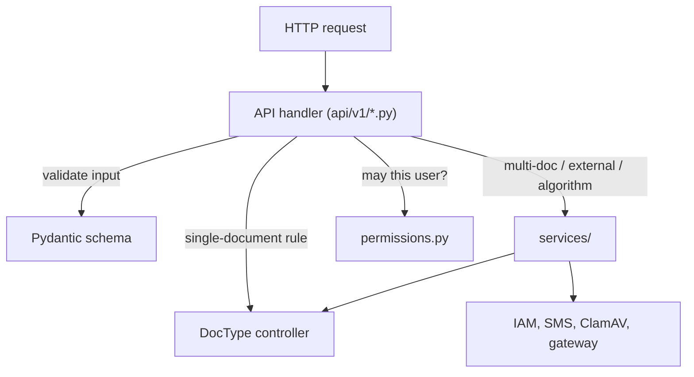

# OAN Frappe Backend Development Best Practices

Rules for every Frappe app in the OpenAgriNet (OAN) ecosystem (`oan_auth_service`,
`oan_grievance_service`, `oan_a2c`, and any new service). The rules are general. Examples
come from the existing apps and show the rule; they are not the rule.

This document covers one thing: how to write and maintain the code. It is the single
source of truth for that, shared by all services. A service's own `docs/` holds only its
business rules and design records.

Throughout this document `<Service>` is the service's display name (`Grievance`, `A2C`,
`OAN`) and `<service>` is its snake_case form (`grievance`, `a2c`, `oan`).

---

## 1. Naming Conventions

### 1.1 The Service Prefix Rule

Every artefact a service owns carries the service name. A Frappe site hosts several apps
and shares one namespace for DocTypes, Roles, Workflows, custom fields, cache keys and RQ
queues. An unprefixed name collides with another app or with Frappe core, and it hides
which app owns the record.

| Artefact                       | Form                             | Examples                                                                   |
| ------------------------------ | -------------------------------- | -------------------------------------------------------------------------- |
| DocType                        | `<Service> <Entity>`             | `Grievance Department`, `A2C Lead`, `OAN User Refresh Token`               |
| Role                           | `<Service> <Persona>`            | `Grievance Officer`, `A2C Bank Agent`, `Grievance Admin`                   |
| Module (`modules.txt`)         | `<Service>` (see §2)             | `OAN Auth`, `A2C Marketplace`                                              |
| Workflow record                | `<Entity> Workflow`              | `Grievance Workflow`, `Organization Workflow`                              |
| Custom field on a core DocType | `<service>_<field>`              | `User.oan_login_email`, `Notification.grievance_recipient_type`            |
| Cache key                      | `<service>:...` or `<service>_…` | `oan_auth:iam_principal:<hash>`, `grievance_role_level_chain`              |
| RQ queue                       | `<service>_<purpose>`            | `grievance_routing`, `grievance_sla`, `grievance_scan`                     |
| Logger / error-log title       | `<app_name>` / `<app_name>: …`   | `frappe.logger("oan_auth_service")`, `"oan_auth_service: IAM unavailable"` |
| Naming series                  | `<SVC>-<ENTITY>-{#####}`         | `GR-AUDIT-{########}`, `GR-RBAC-{#####}`, `GR-NOTIF-{######}`              |
| Site config key                | `<service>_<setting>`            | `iam_base_url`, `jwt_access_token_ttl`                                     |

Exception: the service's primary entity may be the bare service name when the name is
already the prefix (`Grievance`). Every other DocType of that service still carries the
prefix (`Grievance Attachment`, not `Attachment`).

### 1.2 DocType Naming

- **Title Case, singular noun, service prefix.**
  - Good: `Grievance Type`, `A2C Loan Product`, `OAN User Refresh Token`.
  - Bad: `Grievances` (plural), `Grievance_Doc` (snake_case), `a2cLead` (camelCase),
    `Holiday List` (no prefix, collides with ERPNext).
- **Child tables** are named after the parent plus the relation:
  `Grievance RBAC Assignment Officer`, `Grievance Change Request Item`. Set `istable: 1`.
- **Python class and files**: class is PascalCase without spaces
  (`class OANUserRefreshToken(Document)`); folder and files are snake_case
  (`oan_user_refresh_token/oan_user_refresh_token.py`).
- **Do not rename a released DocType** to fix its name. A rename needs a patch, touches
  every Link field, and breaks external clients. Get the name right before the first merge.

### 1.3 Record Naming (`autoname`)

Pick the naming rule by what the record is:

| Record kind                            | Rule                                    | Example                                         |
| -------------------------------------- | --------------------------------------- | ----------------------------------------------- |
| Master / lookup with a natural key     | `field:<key_field>`                     | `Grievance Department` → `field:dept_name`      |
| Transaction / audit / log record       | `format:<SVC>-<ENTITY>-{#####}`         | `GR-HIST-{######}`, `GR-CHG-{#####}`            |
| High-volume rollup rows, child tables  | `hash` / Random                         | `Grievance Stat Daily`                          |
| Public identifier with business format | Script (`autoname()`), one service owns | `ticket_number` via `services/ticket_number.py` |

- Size the counter for the expected volume. Audit events use 8 digits; masters use 4–5.
- Never hand-roll "select max + 1". Use Frappe naming series, which locks the counter.
- Never use a personal identifier (email, phone) as `name`. `name` spreads into `owner`
  and `modified_by` on every row. `oan_auth_service` keeps `User.name` opaque and holds
  the login address in `User.oan_login_email` for this reason.

### 1.4 Field Naming

- `snake_case`. No service prefix inside the service's own DocTypes.
- Booleans read as a predicate: `is_active`, `is_anonymous`, `is_group`, `escalated`.
- Datetimes end in `_at` (`sla_start_at`, `resolved_at`, `escalated_at`); dates end in
  `_date` (`sla_due_date`).
- Quantities state the unit in the name: `sla_days`, `escalation_hours`, `access_token_ttl`
  (seconds, said in the docstring).
- Scope fields that restrict access end in `_scope` (`department_scope`, `category_scope`).
- Link fields name the target, not the type: `service_category`, `administrative_area`,
  not `link1` or `category_link`.
- Fields added to **core** DocTypes always carry the service prefix (§1.1). Define the
  field name once as a constant in the module that creates it and import it elsewhere
  (`LOGIN_EMAIL_FIELD = "oan_login_email"` in `setup/install.py`).

### 1.5 Role Naming & Hierarchy

- **Form**: `<Service> <Persona>`, Title Case. The prefix is mandatory, so a site running
  several OAN apps shows whose role it is.
  - Good: `Grievance Officer`, `Grievance Review Officer`, `A2C Bank Agent`,
    `A2C Development Agent`.
  - Bad: `Officer`, `Bank Agent` (no prefix), `officer_role`, `ROLE_ADMIN`,
    `GrievanceL1Officer`.
- **A role name is a record identifier, not a label.** Renaming it is a data migration: a
  `frappe.rename_doc("Role", old, new, merge=True)` patch plus every DocPerm JSON, Workflow
  and fixture that names it, and often a second patch to merge roles that came back. Name
  it right the first time, and import the name from one constants module (§4).
- **Never create or assign a role from client input** without an allowlist. An endpoint
  that accepts any `role` string re-creates retired roles.
- **A role is a capability, not a rung.** It answers _what actions exist for you_, never
  _which records you may touch_. Seniority (L1, L2, Department Head) is data: a reporting
  chain, a role-level master (`Grievance Role Level`), or a scope assignment
  (`Grievance RBAC Assignment`).
- **Keep the role list short.** Add a role only for a distinct set of actions. A read-only
  oversight persona is a separate role (`Grievance Review Officer`,
  `Grievance Dashboard Reader`) that holds no write DocPerm.
- **No app role has Desk access.** Seed every role the app owns, `<Service> Admin`
  included, with `desk_access = 0`, and keep it that way on every migrate. Every actor
  (end user, staff, service admin) works through the v1 API and the portal.
  Reasons:
  - Desk exposes Frappe's generic list, form and report screens for every DocType the
    role holds DocPerm on. Those screens skip the API's validation, envelopes and
    service-layer rules.
  - Holders stay Website Users and do not use System User seats.
  - Desk is for site operators only, through Frappe's own `System Manager` role and the
    `Administrator` user.

### 1.6 Mandatory `<Service> Admin` Role

Every OAN app **must** define one administrative role for its own domain:

- Examples: `Grievance Admin`, `A2C Administrator`. A new service uses `<Service> Admin`.
- **Purpose**: separate domain administration from Frappe's site-wide `System Manager`
  and the `Administrator` user. A service admin must not need site-wide power.
- **Scope**: full CRUD and configuration on that service's DocTypes (masters, SLA,
  routing, reassignment). No access to other apps or to global site settings.
- **Checks**: admin endpoints and permission predicates accept `<Service> Admin`, with
  `System Manager` and `Administrator` as the ambient fallback, through the one unbound
  check in §5.1.

### 1.7 Code Identifiers

- Constants: `UPPER_SNAKE_CASE`, grouped by meaning with a prefix: `ROLE_*`, `STATE_*`,
  `EVENT_*`, `QUEUE_*`, `DEFAULT_*`, `CACHE_KEY_*`.
- Module-private helpers start with `_`. That includes private modules inside an API
  package (`api/v1/_guards.py`, `api/v1/_schemas.py`, `api/v1/_options.py`), which hold
  shared helpers and register no routes.
- Patch modules are named as a sentence of what they do:
  `move_officer_status_to_officer_rows`, `add_login_email_field`.

---

## 2. Modules: One by Default

**Start with one module per app**, named after the service (`OAN Auth`). Add a second
module only when the app holds so many DocTypes of unrelated contexts that one module is
hard to navigate.

Why one is the default:

- The service prefix (§1.1) already groups the DocTypes. A module adds a second grouping
  that someone has to keep in sync.
- Each module is a folder level in every import path, a `modules.txt` line, a Module Def
  record, a Desk workspace entry, and a decision for every new DocType ("which module?").
- Moving a DocType between modules later is a schema change (`module` in the JSON, the
  folder, every import). Splitting early locks in boundaries before they are known.

What the apps in this bench do:

| App                     | DocTypes | Modules | DocTypes per module |
| ----------------------- | -------- | ------- | ------------------- |
| `helpdesk`              | 36       | 1       | 36                  |
| `oan_a2c`               | 23       | 2       | ~12                 |
| `oan_grievance_service` | 30       | 6       | 5                   |
| `frappe`                | 282      | 10      | ~28                 |
| `erpnext`               | 529      | 20      | ~26                 |

Frappe and ERPNext split only at hundreds of DocTypes, and then into product areas
(Accounts, Stock, Selling) of 25 or more DocTypes each. Helpdesk keeps 36 DocTypes in one
module.

When a split is justified:

- Split by product area (a part of the system a different team or user group owns), not
  by technical kind. `Masters`, `Access Control` and `Notification` are kinds of DocType,
  not areas. They do not need their own modules.
- Name each module `<Service> <Area>` (`A2C Marketplace`) so it keeps the prefix.

### 2.1 Directory Structure

```text
<app_name>/
├── <app_name>/
│   ├── api/
│   │   ├── __init__.py          # version registry, version_meta
│   │   ├── middleware.py        # register_namespace + EXEMPT_PATHS
│   │   ├── router.py            # REST route loader
│   │   └── v1/                  # thin HTTP handlers, one file per resource
│   ├── services/                # domain logic (see §3.3), only when needed
│   │   └── constants.py         # roles, states, events, queues (see §4)
│   ├── <module>/doctype/<doctype>/
│   │   ├── <doctype>.json
│   │   ├── <doctype>.py
│   │   └── test_<doctype>.py
│   ├── config/settings.py       # site_config readers (see §7)
│   ├── setup/install.py         # after_install / after_migrate seeding
│   ├── patches/                 # one module per patch
│   ├── tests/                   # integration and API tests + fixtures.py
│   ├── permissions.py
│   ├── tasks.py                 # scheduled job entry points
│   ├── hooks.py
│   ├── modules.txt
│   └── patches.txt
├── openapi/                     # spec generator + generated specs
├── apisix/  kong/  postman/     # generated gateway and client config
└── docs/
```

---

## 3. Placement of Logic



### 3.1 API Handlers (`api/v1/`)

API handlers are HTTP gateways only. They route, authenticate, validate, call a
controller or service, and return the envelope.

- **No raw SQL and no business logic in handlers.** Semgrep rule
  `oan-no-raw-sql-in-api-layer` enforces the SQL half.
- **Decorator order** is fixed, outermost first:

  ```python
  @route("", methods=("POST",), status=201, summary="Create a greeting")
  @handle_api_errors                          # catches everything below -> error envelope
  @require_permission("Greeting", "create")   # or @require_role(ALLOWED_ROLES)
  @validate_request(CreateGreetingRequest)    # 400 VALIDATION_ERROR on bad input
  @api_doc(summary="Create a greeting", response_model=GreetingResponse)
  def create_greeting(**kwargs): ...
  ```

  - `@handle_api_errors` sits directly under the route, so every failure below it (guard,
    validation, response model, handler) comes back in the same envelope. Every route
    has it (Semgrep `oan-api-missing-error-handler`); handlers never set HTTP status
    codes themselves.
  - The guard runs before validation, so a caller without access gets 403 and learns
    nothing about the request schema.
  - `@api_doc` is innermost: it must sit below `@handle_api_errors` so a
    `ResponseValidationError` is caught and enveloped.

- **Every route has `@api_doc`** with a `response_model`. The OpenAPI generator reads its
  `summary`, `description`, `tags`, `deprecated` and response schema. The
  `response_model` is enforced, not documentation only: a handler that returns the wrong
  shape fails with 500 instead of serving data the client cannot rely on. Define the
  response models next to the request schemas.

- **No `@frappe.whitelist()` on REST routes.** `@route` / `@rest` register the endpoint on
  Frappe's URL map; whitelisting also exposes it at `/api/method/<dotted.path>`, a second
  URL that moves when the file moves. Back this with a static test that fails the build
  on any `whitelist` under `api/` (§12.2); Semgrep `oan-dangling-frappe-whitelist` flags a
  whitelisted function under `api/` that has no route.
- **Every mutating endpoint has a Pydantic schema** with `extra="forbid"`. Share base
  types (`NonBlank`, `Body`, `blank_to_none`) in a private `_schemas.py`. Use
  `RequiredPhone`, `SafeEmail`, `SafeDate` from `oan_auth_service.api.utils`. Bound every
  string and number (`max_length`, `ge`, `le`).
- **PATCH schemas** use `validate_request(Schema, exclude_unset=True)` so omitted fields
  stay omitted.
- **Return through `success_response()`**. Writes return the record as it now stands, so
  the client does not need a follow-up GET.
- **Collections are paginated** with `PageParams` / `page_meta`, a server-enforced
  maximum page size (100), and a unique tie-breaker in `order_by`
  (`"modified desc, name desc"`).
- **Lists fetch named fields only.** No `fields=["*"]` in list endpoints.
- **Guest endpoints** declare `@route(..., allow_guest=True)`. The router registers the
  path as JWT-exempt from that one declaration, so the route and the exemption list
  cannot drift. Use `EXEMPT_PATHS` in `api/middleware.py` only for paths that are not
  `@route`s. Guest endpoints need explicit type hints and a rate limit
  (`check_rate_limit`).
- **Tenant and owner fields are set by the server**, never taken from the request body
  (tenant, `owner`, submitter). Stamp them from the parent record or the session user.

### 3.2 DocType Controller (`doctype/<dt>/<dt>.py`)

The controller owns every rule intrinsic to one record:

1. **Field constants and limits**: lengths, regex, enum tuples, locked states.
   ```python
   class A2CLead(Document):
   	MAX_NOTES_LENGTH = 1000
   	LOCKED_STATUSES = ("Processed", "Granted", "Rejected")
   ```
2. **Lifecycle hooks**:
   - `before_insert`: defaults, generated identifiers, initial state.
   - `validate`: invariants, cross-field checks, link existence and active status.
   - `after_insert` / `on_update`: child rows, audit entries, cache invalidation.
   - `before_submit` / `on_submit`, `before_cancel` / `on_cancel`: submission rules.
   - `on_trash`: deletion guards for referenced records.
3. **Queries about this DocType**: uniqueness against siblings, "active scopes of a user",
   tree bounds. Other modules (including `permissions.py`) import these functions instead
   of writing the query again.

**Controller layout** (from Helpdesk's `HDTeam`): lifecycle hooks sit at the top of the
class and only call methods; the logic lives in named methods below.

```python
class GreetingTeam(Document):
	def validate(self):
		self.validate_head_is_active()
		self.normalise_code()

	def on_update(self):
		self.clear_reference_cache()

	def validate_head_is_active(self): ...

	def normalise_code(self): ...

	def clear_reference_cache(self): ...
```

**Save discipline**:

- Set every field, then call `.save()` once. Do not save inside helper methods.
- A method that changes a related document receives it as an argument and changes it in
  memory; the caller saves it.
- Fetch a document once per hook and pass it down. Do not fetch the same record twice.

### 3.3 Services (`services/`)

Use `services/` only for:

- **Multi-DocType orchestration** in one transaction (reassignment, lifecycle moves).
- **External integrations** (IAM, SMS, ClamAV, gateway config).
- **Domain algorithms** (SLA clock, routing, ticket number format).
- **Background work** called from `tasks.py`.

Services are not for field validation (Pydantic and `validate()` do that) and not thin
wrappers around `frappe.get_all`.

> [!TIP]
> Do not build anemic controllers. If a check reads only the current document, it belongs
> in `validate()`, not in a service.

### 3.4 Go Through the Framework

- Save through `doc.save()` / `doc.insert()` so `validate()`, hooks, versions and
  workflow guards run. `frappe.db.set_value` and `db_set` skip them; use them only for
  deliberate system writes (counters, flags set by a sweep). After `self.db_set(...)`,
  also set `self.field = value` so the in-memory document is not stale.
- Status fields governed by a Workflow change through the workflow engine
  (`apply_workflow`, or one app-level wrapper around it). Never assign `doc.status = "..."` and save.
- Reset a child table with `doc.set("<table_field>", [])` before refilling it.
- Extend core DocTypes through hooks (`doc_events`, custom fields), never by editing
  Frappe or another app.

---

## 4. One Source of Truth for Names and Rules

- **Roles, workflow states, event codes and queue names are constants** in one module
  (`services/constants.py` in `oan_grievance_service`). Code compares against
  `C.STATE_RESOLVED`, never the literal `"Resolved"`. Role sets used in several places
  (`ADMIN_ROLES`, `STAFF_ROLES`) are defined there once.
- **Workflows are data.** Define states and transitions as tables in `setup/install.py`
  and rebuild the Workflow record on every migrate. The Frappe engine decides whether a
  move is legal; the app never keeps a second copy of that answer. Pin the contract with
  a test (`tests/test_workflow_contracts.py`).
- **Fixed workflow, flexible labels.** When tenants need their own status names, keep a
  small fixed set of platform states (archetypes) in the Workflow and map each tenant
  label to one. Code and reports branch on the archetype, never on a label a tenant can
  rename.
- **Variation is data, not code.** Differences by region, tenant or category live in
  master records or settings, not in `if region == ...` branches.
- **Seeds are idempotent** and run from `after_install` and `after_migrate`, so a fresh
  site comes up usable and an existing site converges to the same state.

---

## 5. Permissions Strictly in `permissions.py`

### 5.1 Deny by Default

- DocPerm in the DocType JSON is the role layer and the authoritative grant. Give each
  role the narrowest `read/write/create/delete` set it needs.
- Row-level access is a `permission_query_conditions` hook plus a matching
  `has_permission` hook. The query hook filters list views, reports and the REST API in
  one place; `has_permission` mirrors it for one document.
- Unbound roles (`<Service> Admin`, `System Manager`, `Administrator`) skip the row
  filter. Being unbound does not grant DocPerm the role does not hold.
- **One function decides who is unbound** (for example `is_unrestricted(user)`). Every
  scoping check calls it; no other code lists those roles.
- **Fail closed.** A user with no scope sees nothing: the query hook returns `1=0` and
  `has_permission` returns `False`. A missing scope must never mean "sees everything".
- **Hiding the Desk is not the security wall.** The wall is the JWT middleware plus the
  scoping hooks. No Desk access (§1.5) only removes a second, unreviewed way in.

### 5.2 What Belongs in `permissions.py`

1. The Frappe hooks registered in `hooks.py`.
2. Predicates: `is_unrestricted(user)`, `is_staff(user)`, `can_see_identity(doc, user)`.
3. The module docstring states what belongs there and what does not.

Role constants live in the constants module (§4) and are imported here.

### 5.3 What Does Not Belong

- Inline `frappe.get_roles()` checks in controllers, APIs or templates. Ask a predicate
  in `permissions.py` so each rule has one copy.
- Data lookups (who holds which scope, area containment). They live in the DocType
  module that owns the data and `permissions.py` imports them.

### 5.4 Calls That Bypass the Hooks

- `frappe.get_all`, `frappe.db.get_all`, `frappe.db.get_list` and `frappe.db.get_value`
  ignore `permission_query_conditions`. On a scoped DocType, pass the scope filter
  explicitly or mark the call as exempt with a reason (§5.5). Raw
  `frappe.db.sql` skips them too; apply the filter yourself. Back the rule with a static
  test (§12.2).
- `ignore_permissions=True` is allowed only after the code has done the permission check
  itself (`frappe.has_permission(..., throw=True)`, `require_permission`, or a predicate).
- Background jobs run as a system user. Check the original principal's permission when
  the job runs, not only when it was queued.

### 5.5 Tenant Scoping

When one site holds several tenants (banks, organisations), the scope is the tenant.

- **Two separate facts.** Which tenant a user works for is a User Permission on the user,
  created in the same transaction as the user. Which tenant owns a record is a tenant
  field on the record, copied from the parent record or the creator's binding. Scoping
  compares the two; do not merge them into one field.
- **Keep the list of scoped DocTypes in one place** in `hooks.py`, and register both
  permission hooks for each.
- **`get_all`-style reads on a scoped DocType** either pass the tenant filter through one
  helper (`<tenant>_filters(base=...)`) or carry a `# <tenant>-scope-exempt: <reason>`
  comment. A static test fails the build on any unmarked call.
- **Legacy rows with no tenant** match no tenant, so only unbound roles see them. Backfill
  them with a patch instead of widening the filter.

Adding a tenant-scoped DocType:

1. Add the tenant field, set by the server.
2. Add the DocType to the scoped list and register both hooks.
3. Make every `get_all`-style read on it pass the static scan.
4. Test cross-tenant access both ways: tenant A cannot read or write tenant B's record.

### 5.6 Endpoint Guards

- `@require_role(ROLES)` when the rule is "these personas only".
- `@require_permission("<DocType>", "<ptype>")` when the rule is "whoever DocPerm allows".
  Prefer it: the role list then lives only in the DocType JSON.

### 5.7 Implementation Pattern

```python
# permissions.py
import frappe

from <app_name>.services.constants import ROLE_ADMIN

UNRESTRICTED_ROLES = {ROLE_ADMIN, "System Manager", "Administrator"}


def is_unrestricted(user=None):
	return bool(set(frappe.get_roles(user or frappe.session.user)) & UNRESTRICTED_ROLES)


def grievance_query_conditions(user=None):
	user = user or frappe.session.user
	if is_unrestricted(user):
		return ""
	escaped = frappe.db.escape(user)
	return f"(`tabGrievance`.`owner` = {escaped} OR `tabGrievance`.`assigned_to` = {escaped})"


def has_grievance_permission(doc, ptype="read", user=None):
	user = user or frappe.session.user
	if is_unrestricted(user):
		return True
	...
```

```python
# hooks.py
permission_query_conditions = {
	"Grievance": "<app_name>.permissions.grievance_query_conditions",
}
has_permission = {
	"Grievance": "<app_name>.permissions.has_grievance_permission",
}
```

Always escape values in SQL fragments with `frappe.db.escape`.

---

## 6. Data Model, Schema and Migrations

### 6.1 DocType JSON

- Enable developer mode and edit DocTypes through Desk (or the JSON with care). Commit
  the exported JSON. Do not hand-reformat it.
- Put business uniqueness in the schema (`unique: 1`), not only in a `validate()` check
  that two concurrent requests can race.
- Add `search_index: 1` to fields used in filters on tables that grow (status, assignee,
  due dates). Scheduled sweeps must filter on indexed columns.
- Enable `track_changes` on records whose edits matter for audit.
- Auditable masters are soft-deleted: no `delete` DocPerm, deactivate with
  `is_active = 0`.
- Store files through Frappe `File` and reference them. No binary content in rows.

### 6.2 Custom Fields on Core DocTypes

- Prefix the field name with the service (§1.1).
- Create it with `create_custom_field` from a function in `setup/install.py`.
- Call that function from **both** `after_install` and a patch. `bench install-app`
  marks existing patches as applied without running them, so a patch alone misses fresh
  sites (including the CI site), and `after_install` alone misses existing sites.
- A patch that retires a custom field also deletes the `Custom Field` record, so core
  DocTypes return to their original shape.

### 6.3 Patches

- `patches.txt` is **append-only**. Add the new line at the end; never reorder, rename or
  remove lines.
- Put a patch in `[post_model_sync]` unless it must run before the schema changes.
- A patch is idempotent: guard with `frappe.db.has_column`, `frappe.db.exists`, or a
  state check, so a re-run does nothing.
- Use `frappe.qb` or parameterized `frappe.db.sql`. Batch large updates; do not hold
  long locks on growing tables.
- Start each patch with a docstring that says what moves and why.

### 6.4 Fixtures and Seeds

- Roles are seeded in `setup/install.py` (or exported as fixtures listed in `hooks.py`
  and committed to `<app_name>/fixtures/`). Pick one mechanism per app.
- Reference data that the code depends on by name (fallback category, unrouted desk) is
  seeded and named by a constant.

---

## 7. Configuration

- Read tunables from `site_config.json` through functions in `config/settings.py`, never
  through module constants. A function re-reads `frappe.conf`; a constant pins the value
  until the worker restarts.
- Each setting has a named default (`DEFAULT_ACCESS_TOKEN_TTL = 15 * 60`) with a comment
  that explains the value.
- List every key with an example in the module docstring.
- Defaults fail closed (for example `jwt_issuer` defaults to the site name, so tokens
  from staging fail in production).
- No secrets in code, fixtures, logs or committed config. Use `frappe.conf` / encrypted
  `Password` fields.

---

## 8. Background Jobs, Scheduling and Caching

### 8.1 Background Jobs

- Long work (scans, routing, notifications, rollups) never runs inside a web request.
  Use `frappe.enqueue`.
- Give the service its own queues (`QUEUE_ROUTING = "grievance_routing"`) so one backlog
  cannot starve the others. Declare each queue under `workers` in
  `common_site_config.json`, or `frappe.enqueue` rejects it.
- Enqueue from a transaction with `enqueue_after_commit=True`, so the job does not run
  against rows that roll back.
- Sweeps that may overlap use a stable `job_id` and `deduplicate=True`.
- Jobs are idempotent and safe to retry.

### 8.2 Scheduled Jobs

- Entry points live in `tasks.py` and are registered in `hooks.py`
  `scheduler_events`, each with a comment that says why it runs at that frequency.
- A scheduled job enqueues the real work on a service queue and returns.
- Every job handles and logs its own errors. A silent failure is a bug.

### 8.3 Caching

- Prefix cache keys with the service (§1.1). Define each key as a constant.
- Invalidate in the owner's `on_update` / `on_trash` / `after_delete` hooks (for example
  `doc_events` → `clear_reference_cache`).
- Set `expires_in_sec` on cached values derived from external systems.
- Never trust a cached value for an authorization decision without a way to revoke it.

---

## 9. Errors, Logging and Internationalization

- Raise with `frappe.throw(_("..."), exc=<FrappeError>, title=_("..."))`. The exception
  class decides the HTTP status: `ValidationError` → 400, `PermissionError` → 403,
  `DoesNotExistError` → 404, `AuthenticationError` → 401.
- Every user-facing string goes through `_()`. Use positional placeholders with
  `.format()` after `_()`, not f-strings inside `_()`
  (`_("Category '{0}' does not exist.").format(name)`).
- Log through `frappe.logger("<app_name>")` or `frappe.log_error(title="<app_name>: …")`.
  No `print()`, `console.log` or `debugger` in committed code.
- Log an error once, at the layer that handles it, with enough context to act on it. Do
  not log secrets, tokens, OTPs or full personal data.
- Rate-limit noisy logs of an external outage (cache a "logged" flag with a window).

---

## 10. Cross-Service Integration

- A consuming app declares `required_apps = ["oan_auth_service"]` so bench installs the
  dependency first.
- Register the API namespace and exempt paths with
  `oan_auth_service.api.middleware.register_namespace()` at module import time, so every
  worker process has it. Do not register inside a request handler.
- Extend shared behaviour through the published hooks, not by importing private
  functions: `on_user_registered`, `on_user_profile`, `on_access_token_claims`,
  `on_metadata`. A hook that fails during registration aborts the account creation.
- Put service-specific data in a namespaced profile, not in the shared token claims.
- A shared library contains no business rules owned by a single service.

---

## 11. Code Style and Comments

- Ruff formats Python: tabs, double quotes, line length 110, sorted imports.
- Start every Python file with the copyright header:
  ```python
  # Copyright (c) 2026, COSS - Centre for Open Societal Systems and contributors
  # For license information, please see license.txt
  ```
- Every module has a docstring that says what it is for. Modules that collect rules
  (`permissions.py`, `constants.py`, `settings.py`) also say what does not belong there.
- Comments explain _why_ (a constraint, a Frappe quirk with a file:line reference, a
  rejected alternative). Do not narrate what the code does.
- Group `hooks.py` into commented sections (Apps, Authentication, Installation,
  Permissions, Document Events, Scheduled Tasks) and say why each hook exists.
- Keep functions small and files under ~300 lines; split by responsibility. Public
  functions at the top, low-level helpers at the bottom.
- Add an abstraction only after two or three concrete uses.
- Use `frappe.utils.now_datetime()` / site time zone helpers, not `datetime.now()`.
- Use type hints on public functions and on every route handler parameter.
- For new queries prefer `frappe.qb` (or `frappe.qb.get_query(...)`, which applies
  permissions unless told not to) over string SQL.

### 11.1 Documentation

- A feature with a spec in `docs/` keeps that spec current **in the same change** as the
  code. The spec describes what is built, not what was planned; remove sections for
  removed behaviour.
- Endpoint reference is generated into `openapi/`, not written by hand.

---

## 12. Testing

```
┌──────────────────────────────────────────────┐
│  Integration / API tests (tests/)            │  REST, multi-DocType, hooks, jobs
├──────────────────────────────────────────────┤
│  DocType unit tests (doctype/<dt>/test_*.py) │  validate(), lifecycle, limits
└──────────────────────────────────────────────┘
```

### 12.1 Placement

- **One test file per DocType**, next to it: `<module>/doctype/<dt>/test_<dt>.py`. It
  tests only that DocType. No extra test files inside a DocType folder.
- **Everything cross-cutting goes in `tests/`**: API endpoints, routing, SLA, workflows,
  background jobs, cross-service hooks. Name files by area and topic
  (`test_sla_engine.py`, `test_auth_must_change_password.py`).
- **A new area of behaviour gets a new file**, not a new class appended to a busy one.
  Two branches then add two files instead of colliding at the end of one.
- **Never name a test file after a PR or ticket** (`test_pr19_review_fixes.py`). Add the
  regression case to the file for that area.
- **Shared helpers live in one module** (`tests/utils.py`, `tests/fixtures.py`,
  `tests/request_context.py`). Check there before writing a helper; move any
  helper you wrote inline into it before you finish. Name factories `make_<doctype>()`
  and toggles `enable_<feature>()` / `disable_<feature>()`, each with a docstring.

### 12.2 Writing Tests

- Inherit from `frappe.tests.utils.FrappeTestCase` (or the app's base case built on it).
- Do not call `frappe.db.commit()` in tests. It leaks state into later tests. If a test
  must cross a commit (enqueue after commit, a second connection), isolate it in a base
  class that cleans up explicitly.
- Test with the real MariaDB, not mocks, when the behaviour depends on constraints,
  transactions or queries. Mock only external services (IAM, SMS, ClamAV).
- **Each test class owns its data.** Create fixtures with a unique suffix
  (`frappe.generate_hash(length=6)`) in `setUpClass` and delete them in `tearDownClass`.
  Never reuse a record with `if not frappe.db.exists(...)`, and never pick up whatever
  record exists (`frappe.db.get_value("<DocType>", {}, "name")`). Leftover local data
  hides broken fixtures that fail on CI's clean database.
- **No order-dependent tests.** Do not number tests (`test_01_...`) to force an order.
  Every class must pass when run alone.
- **Enforce conventions with static tests** where a reviewer would miss a violation:
  AST scans that fail the build on unscoped `get_all` on tenant-scoped DocTypes, on
  `@frappe.whitelist` under `api/`, or on routes without `@handle_api_errors`.

### 12.3 What Every Endpoint Test Covers

1. Happy path: status 200, envelope shape, side effects (timeline, SLA, audit rows).
2. Invalid input: missing, blank, too long, out-of-range, unknown fields → 400.
3. Guest → 401 on protected paths; Guest allowed on exempt paths.
4. Wrong role → 403 (for example a staff role on an admin endpoint).
5. Row scope: a user cannot read or change a record outside their scope.
6. Immutable fields cannot change through PATCH.
7. Pagination bounds (`page_size` above the maximum).
8. Duplicate and concurrent calls for idempotent or locked operations.

### 12.4 Werkzeug API Testing

Call the REST layer in-process with a Werkzeug request; no HTTP server.

```python
# tests/utils.py
import frappe
from werkzeug.test import EnvironBuilder
from werkzeug.wrappers import Request


def make_test_request(path, method="GET", data=None, headers=None, scheme="http"):
	builder_kwargs = {
		"path": path,
		"method": method.upper(),
		"base_url": f"{scheme}://testsite.localhost",
		"headers": headers or {},
	}
	if data is not None:
		builder_kwargs["json"] = data
	req = Request(EnvironBuilder(**builder_kwargs).get_environ())
	frappe.local.request = req
	frappe.local.request_ip = "127.0.0.1"
	frappe.local.form_dict = frappe._dict(data or {})
	frappe.local.response = frappe._dict({})
	return req
```

```python
# tests/test_router.py
import json

import frappe.api
from frappe.tests.utils import FrappeTestCase

from <app_name>.tests.utils import make_test_request


class TestGreetingEndpoints(FrappeTestCase):
	def test_create_greeting(self):
		req = make_test_request("/api/v1/greetings", "POST", {"recipient_name": "Alice"})
		res = frappe.api.handle(req)
		self.assertEqual(res.status_code, 200)
		self.assertEqual(json.loads(res.get_data(as_text=True))["status"], "success")
```

### 12.5 Running

```bash
bench --site <site> run-tests --app <app_name>
bench --site <site> run-tests --app <app_name> --doctype "<DocType>"
bench --site <site> run-tests --app <app_name> --module <app_name>.tests.test_router
```
