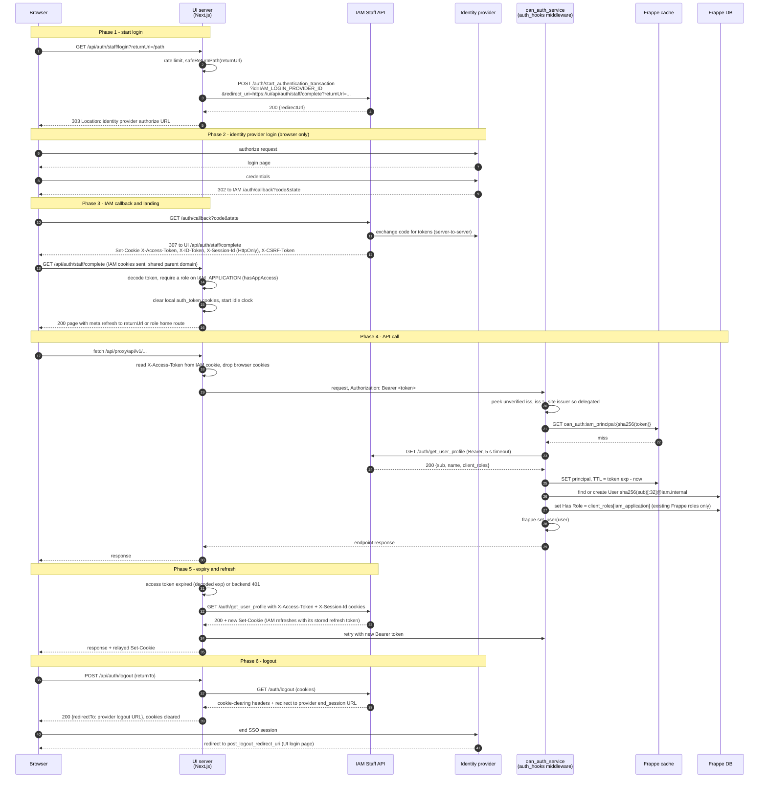

# Staff Login Flow (Grievance UI → IAM → Identity provider → oan_auth_service)

Route a "Sign in as staff" login takes through the OAN grievance stack: the Next.js UI (`oan_grievance_ui`), the OpenG2P IAM service, the identity provider behind IAM, and this app (`oan_auth_service`, a Frappe app).

How this was written:

- **Code only.** Nothing was traced against a running stack. Read from this app (`api/middleware.py`, `api/iam_tokens.py`, `api/iam_users.py`, `config/settings.py`, `api/v1/auth.py`, `api/v1/admin.py`, `gateway_apisix.py`) and from `oan_grievance_ui` (`src/lib/iamSession.ts`, `activeSession.ts`, `session.ts`, `jwt.ts`, `proxy.ts`, `app/api/auth/{staff/login,staff/callback,staff/complete,me,refresh,logout}`, `app/api/proxy/[...path]`).
- IAM's own behaviour (its endpoints, cookies, token refresh, logout redirect) is as these two codebases assume it. IAM source was not read.
- Design reasoning: `IAM_DELEGATED_LOGIN_PLAN.md`. Config and usage: "Delegated login" in `README.md`.

## Components

| Name                 | What it is                                                                                                                                                 |
| -------------------- | ---------------------------------------------------------------------------------------------------------------------------------------------------------- |
| Browser              | The user's browser                                                                                                                                         |
| UI browser half      | React pages from `oan_grievance_ui`                                                                                                                        |
| UI server half       | Next.js route handlers (`/api/auth/*`, `/api/proxy/*`) in the same app. The only thing that calls IAM or this app                                          |
| IAM Staff Portal API | Runs the OIDC login, sets session cookies, validates and refreshes tokens, holds the refresh token. Config: `IAM_BASE_URL` (UI), `iam_base_url` (this app) |
| Identity provider    | Keycloak (or eSignet, ...). Behind IAM; neither the UI nor this app talks to it, except the browser being redirected to it                                 |
| oan_auth_service     | Frappe app. Validates the token through IAM, provisions a local `User`, syncs roles, then Frappe RBAC applies                                              |
| Frappe cache (Redis) | Holds the IAM principal per token and two log-throttle flags                                                                                               |

The browser never calls IAM's API. It only calls the UI's own routes. The one exception is IAM's OAuth callback, which the identity provider redirects the browser to (unless the optional UI callback route is used, below).

## Sequence diagram

## Step-by-step

### Phase 1 - start login (UI)

1. The login page shows "Sign in as staff" only if `IAM_BASE_URL` is set (`staffSignInEnabled`). The button is a page navigation to `/api/auth/staff/login`, not a `fetch`, because the browser must follow the provider's redirects.
2. The route is rate limited (`staffLogin`). A tripped limit or missing config sends the browser to `/login?reason=staff_unavailable`.
3. The UI builds the **landing URL**: an absolute `https://<ui>/api/auth/staff/complete`, plus `returnUrl` (the page to land on) after `safeReturnPath`. It must be absolute and point at this app, because IAM redirects to it without validating it (a bare path would resolve against IAM's host).
4. Server-to-server `POST {IAM_BASE_URL}/auth/start_authentication_transaction?id={IAM_LOGIN_PROVIDER_ID}&redirect_uri={landing URL}`, 10 s timeout, no redirects followed. IAM answers `{redirectUrl}`. The UI accepts only `http`/`https` URLs and answers the browser `303` to it. IAM refusal sets `staff_unavailable`.

### Phase 2 - identity provider login

5. Browser logs in at the identity provider. IAM and the provider own this step; this app and the UI see none of it.

### Phase 3 - callback and landing

6. The provider sends the browser to IAM's `/auth/callback?code&state`. IAM exchanges the code, keeps the refresh token server-side, and answers with a redirect to the landing URL plus four cookies on the shared parent domain.
7. **Optional variant:** if the IAM login-provider row's `oauth_callback_url` is `<ui>/api/auth/staff/callback`, the provider sends the browser to the UI instead. The UI hands the query to IAM's `/auth/callback` server-to-server, re-emits IAM's `Set-Cookie` headers unchanged, and redirects to the landing URL only if it is the UI's own `/api/auth/staff/complete` (same origin, exact path). Otherwise `staff_failed`. This keeps IAM out of the browser entirely.
8. `/api/auth/staff/complete` reads IAM's cookies:
   - no readable access token: `staff_failed`
   - claims hold no role on `IAM_APPLICATION` (`hasAppAccess`): `staff_no_access`. The IAM session is left alone, it is valid for other apps
   - otherwise it clears any local `auth_token`/`refresh_token`/`session_remember` cookies, so the two session kinds cannot mix, and starts the idle-clock cookie
9. It answers a small HTML page with a meta refresh, not a `30x`. The redirect chain began at the identity provider (cross-site), and a browser withholds `SameSite=Strict` cookies, the idle cookie among them, on every hop of such a chain. A navigation the page starts itself is same-site.
10. Target is `returnUrl` (sanitised again) or the home route for the user's roles.

### Phase 4 - API call

11. The browser calls `/api/proxy/...`. `readActiveSession` picks the session: a local session (`auth_token`) wins if present, otherwise the IAM session if `hasAppAccess`.
12. The proxy forwards to `AUTH_API_BASE_URL` with `Authorization: Bearer <IAM access token>`. **Browser cookies are deliberately not forwarded** (`proxyHeaders.ts`). So the cookie path in this app's middleware is not used by this UI. State-changing proxy calls pass the UI's own same-origin check (`checkCsrf`: `Sec-Fetch-Site`, `Origin` vs `Host`).
13. Frappe runs `validate_jwt_request` (an `auth_hook`, last in `validate_auth`). If something earlier already set a non-Guest user, it does nothing. The path is matched to a registered namespace (longest prefix). No match: Frappe's own auth.
14. Token source in the middleware, in order: Bearer header; else `X-Access-Token` cookie (with `iam_auth_cookie_prefix`); else exempt path continues as guest, any other path `401`.
15. `iam_tokens.peek_issuer` reads `iss` **unverified**, only to route:
    - `iss == settings.issuer()` (site name or `jwt_issuer`): own token, verified in-process
    - anything else: delegated, goes to IAM
16. `get_principal(token)`:
    - cache key `oan_auth:iam_principal:{sha256(token)}`; a hit skips IAM
    - miss: fail if `iam_base_url` is unset or not `https` (loopback and `iam_allow_insecure_http` excepted); else `GET {iam_base_url}/auth/get_user_profile`, Bearer, 5 s timeout, `allow_redirects=False`

| IAM answer                              | Result here                                                          |
| --------------------------------------- | -------------------------------------------------------------------- |
| `200` JSON object with `sub`            | Principal cached until token `exp` (60 s if none), request continues |
| `200` non-JSON, non-object, or no `sub` | `401`                                                                |
| Other `4xx`                             | `401`                                                                |
| `5xx`, timeout, unreachable             | `503 Identity service unavailable`                                   |
| `iam_base_url` unset or insecure        | `401`                                                                |

    Only `sub`, `name` and `client_roles` are read. Rejected tokens are not cached.

17. Provision (`_provision_delegated_user`):
    - local user name: `<sha256(sub)[:32]>@iam.internal`. Identity is `sub`, not email
    - roles to grant: `client_roles[iam_application]` that also exist as Frappe `Role`. Names used as-is
    - none granted (including `iam_application` unset): `401`, user never created. An existing user is stripped first
    - first sight: `User` created with `ignore_permissions`, no password, no welcome email, `enabled=1`; `first_name`/`last_name` from `name` split on the first space (`IAM User` if blank). A first-request race is caught as `DuplicateEntryError`
    - `sync_roles` makes `Has Role` equal the granted set
    - on GET/HEAD/OPTIONS the middleware commits explicitly when something changed (Frappe rolls those back); unsafe methods commit on success
18. Shared checks: user exists and is `enabled`; `must_change_password` unset; the consumer's optional `revocation_check(user)` passes.
19. `frappe.set_user(user)`. Frappe DocPerm now authorizes. `frappe.local.oan_auth_claims` holds the principal and `frappe.local.oan_auth_issuer_kind` is `"iam"` (own tokens: `"local"`).

### Phase 5 - expiry and refresh

20. This app never refreshes a token and never sets cookies. An expired token is `401`.
21. IAM has no refresh endpoint. Its auth middleware refreshes an expired token on any authenticated route and returns new cookies. The UI therefore calls `GET /auth/get_user_profile` (a GET, so no CSRF token needed) with the `X-Access-Token`, `X-Session-Id` and `X-ID-Token` cookies. Both access token and session id cookies must be present.
22. Where it happens in the UI:
    - `/api/auth/me` (session restore) and `/api/auth/refresh`: renew when the decoded token is expired
    - `/api/proxy/*`: renews **before** the call when the decoded `exp` has passed (this app caches IAM's verdict until `exp`, so an expired token is a guaranteed `401`); otherwise renews after a backend `401` and retries once. A renewed token identical to the old one means the `401` was a real answer, so no retry
    - on success the UI relays IAM's `Set-Cookie` headers and slides the idle clock; on failure it clears all session cookies
23. IAM's idle and maximum session lifetime belong to IAM and the provider. The UI idle clock applies to **local sessions only**, and an idle kick clears only local cookies, never IAM's (that would sign the user out of other OpenG2P apps).

### Phase 6 - logout

24. `POST /api/auth/logout` (same-origin checked, rate limited) calls IAM `GET /auth/logout` with the cookies. IAM drops its refresh token and answers with cookie-clearing headers and a redirect to the provider's `end_session_endpoint`.
25. The UI does not follow that redirect. It swaps `post_logout_redirect_uri` for its own page (`returnTo`, default `/login`) and returns it as `redirectTo`. The client navigates there so the provider's SSO session ends (it lives in browser cookies). The target must be on the provider client's redirect allow-list.
26. Cookies are cleared locally first, then IAM's own clearing headers are applied last, because they carry the exact cookie domain. Logout is best effort: if IAM fails, local cookies still clear.
27. Backchannel logout (session ended inside the provider) is IAM's business. Because this app caches the principal until `exp`, an already-issued token still works here until it expires.

## Cookies

IAM sets four cookies on the shared parent domain. Which side reads which:

| Cookie           | HttpOnly | UI server reads                              | This app reads                                          | Purpose                               |
| ---------------- | -------- | -------------------------------------------- | ------------------------------------------------------- | ------------------------------------- |
| `X-Access-Token` | yes      | Yes: forwards as Bearer, decodes for routing | Only if called with cookies and no Bearer (not this UI) | Access token JWT                      |
| `X-ID-Token`     | yes      | Only to pass to IAM logout (`id_token_hint`) | No                                                      | Who logged in                         |
| `X-Session-Id`   | yes      | Yes: needed for refresh and logout           | No                                                      | Pointer to IAM's stored refresh token |
| `X-CSRF-Token`   | no       | No (UI uses its own same-origin check)       | Yes, on the cookie path                                 | Double-submit CSRF                    |

- All names get a prefix: UI `IAM_COOKIE_PREFIX`, this app `iam_auth_cookie_prefix`, both must equal IAM's `auth_cookie_prefix` (`common_auth_cookie_prefix`). Default empty. The `X-CSRF-Token` **header** is never prefixed.
- `IAM_COOKIE_DOMAIN` (UI) must equal IAM's cookie domain. It is used only to expire the cookies locally when IAM refuses to renew.
- The refresh token never reaches the browser, the UI or this app.
- The UI's own local-login cookies (`auth_token`, `refresh_token`, `session_remember`, `last_activity`) are `SameSite=Strict`. IAM's cookies are IAM's attributes, relayed unchanged.

## Cookie path in this app's middleware (not used by this UI)

Kept for browsers that call this app directly with IAM's cookies.

|            | Bearer                          | Cookie                                           |
| ---------- | ------------------------------- | ------------------------------------------------ |
| Source     | `Authorization: Bearer <token>` | `X-Access-Token` cookie, no Authorization header |
| CSRF check | None                            | Required for non-exempt, non-GET/HEAD/OPTIONS    |
| Verifier   | By `iss`                        | By `iss` (same)                                  |
| Expired    | `401`                           | `401`                                            |

CSRF: header `X-CSRF-Token` must equal the CSRF cookie (`hmac.compare_digest` on bytes, so non-ASCII gives `401`, not `500`). Needs IAM's cookie `Domain` to cover this host and credentialed CORS for the frontend origin; this app configures neither.

On an **exempt** path (login, refresh, reset), a cookie that fails any check is treated as "no credentials", not `401`, so a stale cookie cannot lock the user out. Those rejections log at info level only. A Bearer token on an exempt path is still validated and can still fail.

## Two sessions, two verifiers

|                   | Local session                                          | Staff (IAM) session                                  |
| ----------------- | ------------------------------------------------------ | ---------------------------------------------------- |
| Opened by         | Email/password form, `api/v1/auth.py`                  | "Sign in as staff", IAM                              |
| UI cookies        | `auth_token`, `refresh_token`, `session_remember`      | IAM's `X-*` cookies (never copied)                   |
| Token `iss`       | `settings.issuer()`                                    | Anything else                                        |
| Verified by       | This app in-process                                    | IAM via `get_user_profile`                           |
| Refresh           | This app's refresh token (rotation)                    | IAM, triggered through `get_user_profile`            |
| Local `User.name` | token `sub`                                            | `sha256(sub)[:32]@iam.internal`                      |
| Roles from        | Frappe roles at issue, `scope` re-checked each request | `client_roles[iam_application]`, synced each request |
| Idle timeout      | UI idle clock                                          | IAM / provider                                       |
| Password          | Allowed                                                | Never                                                |

A local session wins in the UI if the browser somehow holds both.

## Roles, end to end

| Where             | What                                                                                                                            |
| ----------------- | ------------------------------------------------------------------------------------------------------------------------------- |
| Identity provider | Client roles on a client named like the application                                                                             |
| IAM               | Puts them in the principal as `client_roles[<application>]` and in the Keycloak token as `resource_access[<application>].roles` |
| UI                | Decodes `resource_access[IAM_APPLICATION].roles` (unverified) for routing: `hasAppAccess`, home route, `canAccessRoute`         |
| This app          | Uses `client_roles[iam_application]` from IAM's answer; sets Frappe roles; Frappe DocPerm enforces                              |

- `IAM_APPLICATION` (UI) and `iam_application` (this app) must hold the same value, or the UI shows a page the API then refuses.
- UI claims are display and routing only. The backend re-verifies every call.
- Role names are used **as-is**. A role missing in Frappe is ignored. No allowlist: whoever administers the application's client in IAM can grant any existing Frappe role, `System Manager` included. Accepted for now.
- Role change in IAM applies when the user gets a new token, not on the next request (principal cached until `exp`).
- Roles of delegated users cannot be edited through `api/v1/admin.py` ("Roles for IAM-delegated users are managed by the identity provider").

## No local password for delegated users

`is_delegated_user` is true for names ending `@iam.internal`. All password flows start from the login-handle lookup in `api/v1/auth.py`, which returns `None` for them, and `set_temporary_password` throws. A password set through a reset mail would outlive the person's removal from the identity provider.

## Gateway

`gateway_apisix.py` with `gateway_jwt=False` (default): the gateway rate-limits, caps bodies and handles CORS, but does not verify tokens. Bearer routes go to Frappe, whose middleware accepts both own and IAM tokens. With `gateway_jwt=True`, `jwt-auth` on bearer routes accepts only tokens from the configured `consumers`, which refuses IAM tokens at the gateway.

## Config that must agree

| Setting        | UI (`oan_grievance_ui`)      | This app (`site_config.json`)               | Must equal                                      |
| -------------- | ---------------------------- | ------------------------------------------- | ----------------------------------------------- |
| IAM address    | `IAM_BASE_URL` (server-only) | `iam_base_url` (`https`, loopback excepted) | Same IAM (URL may differ by network path)       |
| Application    | `IAM_APPLICATION`            | `iam_application`                           | Same value, and the client name in the provider |
| Cookie prefix  | `IAM_COOKIE_PREFIX`          | `iam_auth_cookie_prefix`                    | IAM `auth_cookie_prefix`                        |
| Cookie domain  | `IAM_COOKIE_DOMAIN`          | n/a                                         | IAM cookie domain                               |
| Login provider | `IAM_LOGIN_PROVIDER_ID`      | n/a                                         | Row id in IAM `login_providers`                 |
| Insecure IAM   | n/a                          | `iam_allow_insecure_http`                   | Trusted private network only                    |
| Own issuer     | n/a                          | `jwt_issuer` (default site name)            | Anything else routes to IAM                     |

IAM-side requirements: the login-provider row's `oauth_callback_url` is IAM's `/auth/callback` (or the UI's `/api/auth/staff/callback` for the optional variant); the UI's landing and post-logout URLs must be on the provider client's redirect allow-list; IAM's cookie domain must cover both the UI and the host the browser uses.

## Cache keys (Frappe cache)

| Key                                      | Created                                       | TTL                                      |
| ---------------------------------------- | --------------------------------------------- | ---------------------------------------- |
| `oan_auth:iam_principal:{sha256(token)}` | First successful validation of a token        | Token `exp` minus now (60 s if no `exp`) |
| `oan_auth:iam_outage_logged`             | First IAM outage failure                      | 60 s                                     |
| `oan_auth:iam_insecure_url_logged`       | First rejection of a non-https `iam_base_url` | 3600 s                                   |

## Troubleshooting

Redirect reasons on `/login?reason=`:

| Reason              | Cause                                                                                              |
| ------------------- | -------------------------------------------------------------------------------------------------- |
| `staff_unavailable` | `IAM_BASE_URL` unset or misconfigured, rate limit hit, or IAM refused to start the transaction     |
| `staff_failed`      | No session after the callback, or the optional callback route got a bad `state`/non-UI landing URL |
| `staff_no_access`   | Signed in at IAM but no role on `IAM_APPLICATION`                                                  |

Other:

- **Every IAM token gets `401` from the API** - check `iam_base_url` (set, `https` or loopback) and `iam_application` (set). Error Log has `iam_base_url is not https` or `iam_application not set`.
- **Login completes, UI shows app, API returns `401`** - principal has no role for `iam_application`, or none of the role names exist in Frappe. Server log: `Principal ... has no roles for this application`. Check the two application values match and role names match Frappe `Role` names exactly.
- **`503 Identity service unavailable`** - IAM unreachable, timed out (5 s) or answered 5xx. Logged once a minute. The UI should retry, not sign the user out.
- **Refresh silently fails and user is signed out** - `X-Session-Id` or `X-Access-Token` cookie missing, or IAM's refresh token expired.
- **Cookies never reach the UI** - IAM cookie `Domain` does not cover the UI host.
- **Role change in IAM not visible** - cached principal; applies on the next token.
- **Stripped roles reappear after a failed POST** - Frappe rolls back a rejected unsafe request; the strip commits on the next safe-method request.
- **Logout does not end provider session** - IAM failed or gave no redirect; the UI still clears local cookies. Check the post-logout URL is on the provider allow-list.

## Known gaps and issues

- **`aud` not enforced** by IAM, so a valid token for another application is accepted. The role requirement is what keeps such callers out.
- **Bearer token lives until `exp`.** To cut someone off sooner, disable their local `User`. Provider-side logout does not invalidate an issued token here.
- **No role allowlist** (see Roles). Follow-up: `iam_role_map` in site config.
- **IAM does not validate the post-login `redirect_uri`.** The UI therefore builds an absolute own-origin landing URL and re-checks `returnUrl` on arrival. Do not weaken that.
- **Two sets of claims.** The UI decodes roles from `resource_access` (Keycloak shape) while this app reads IAM's `client_roles`. Another identity provider that IAM normalises differently could make the UI's routing disagree with the API.
- **CSRF double-submit** (cookie path) is not signed or session-bound. If IAM sets cookies on a parent domain, a sibling subdomain can set both cookie and header. Do not host untrusted subdomains under that domain.
- **Unthrottled IAM calls.** Rejected tokens are not cached and validation is a synchronous 5 s call. An unauthenticated caller can send JWT-shaped strings with a foreign `iss`, each causing one IAM call. Mitigation: per-IP `rate-limiting` at the gateway. Follow-up: lower timeout and circuit breaker.
- **Last-role strip** commits only on safe methods (see Troubleshooting).
