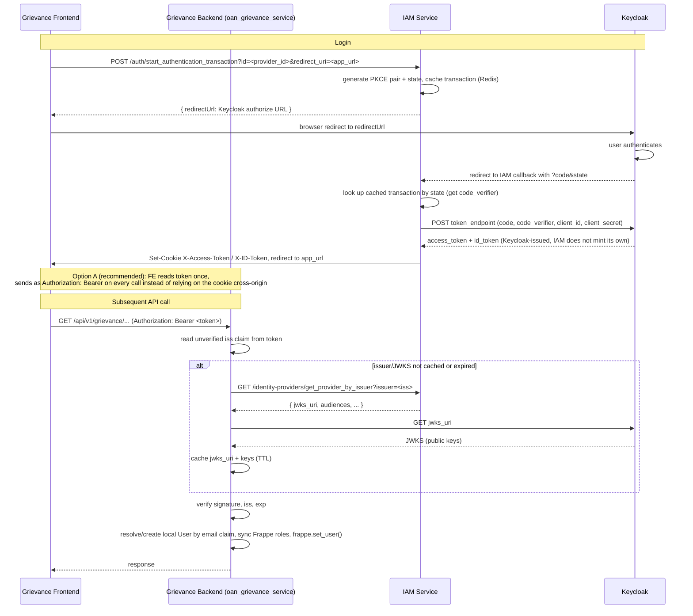

# Plan: Delegate login to OpenG2P's IAM service, with cookie-based session

## Sequence diagram



## Goal

Rather than building Keycloak OAuth (PKCE, token exchange, JWKS verification) directly inside `oan_auth_service`: let the frontend log in **directly against the existing OpenG2P IAM service** — the same one registry staff-uis already use — and have `oan_grievance_service` (or any other `oan_*` service) validate the resulting session without re-implementing IAM's own OAuth plumbing.

This trades independence (oan_auth_service doesn't need its own Keycloak client/PKCE code at all) for a cross-service dependency on IAM's availability and cookie semantics. Both are legitimate; this document describes the second one precisely, since it's the one with real sharp edges.

## What IAM actually does today (established from reading its code directly, not assumed)

- IAM holds the real Keycloak client credentials (`client_id`/`client_secret`, confidential client) in its own `login_providers` DB table. Frontend never sees the secret.
- `POST /auth/start_authentication_transaction` — frontend calls this, IAM generates PKCE pair + `state`, stores the transaction (Redis), returns a Keycloak `redirectUrl`.
- Browser redirects to Keycloak, logs in, comes back to IAM's own callback.
- IAM's callback exchanges the code (using `code_verifier` it held, plus its own client secret) directly with Keycloak's token endpoint, gets back **Keycloak's own tokens** — IAM does not mint a token of its own, it passes Keycloak's through.
- IAM sets those tokens as cookies on its own response: `X-Access-Token`, `X-ID-Token` (seen directly in `requireAuth.ts` on the registry staff-ui, which reads `req.cookies.get('X-Access-Token')`).
- Every subsequent request to IAM-aware backends carries that cookie; `TokenValidatorService.validate()` reads the token, looks up the matching `login_providers` row by the token's `iss` claim (Keycloak's issuer, not IAM's), fetches Keycloak's JWKS from that row's config, and verifies.

So: **the token in the cookie is Keycloak's token.** IAM is a login-flow proxy and cookie-setter, not the signer. This matters for everything below.

## Step 1: frontend logs in against IAM directly

No change needed to IAM itself. The grievance frontend calls IAM's existing endpoints exactly as a registry staff-ui would:

```
POST https://iam.<domain>/auth/start_authentication_transaction?id=<provider_id>&redirect_uri=<frontend's own post-login URL>
→ { redirectUrl: "https://keycloak.../auth?...&code_challenge=...&client_id=..." }
```

Browser follows `redirectUrl`, authenticates at Keycloak, comes back to IAM's own `/auth/callback`, IAM exchanges the code, sets `X-Access-Token`/`X-ID-Token` cookies on **IAM's origin**, then redirects the browser to the `redirect_uri` the frontend originally supplied.

## Step 2: the cookie domain problem

This is the part that breaks if not handled deliberately. Cookies are scoped by `Domain` + `SameSite`, and IAM, the frontend, and `oan_grievance_service`'s backend are very likely three different origins (`iam.<domain>`, the grievance frontend's own origin, and `grievance-api.<domain>` or similar).

A cookie set on `iam.<domain>` is **not** automatically sent by the browser to `grievance-api.<domain>`'s requests, unless:

- Both share a common parent domain, **and**
- IAM's cookie is set with `Domain=.<parent-domain>` (not the default host-only scoping), **and**
- `SameSite`/`Secure` attributes are compatible with the cross-subdomain request pattern actually used (`SameSite=Lax` is enough for same-site subdomain navigation/fetch; `SameSite=None; Secure` would be needed if treated as genuinely cross-site).

If IAM's cookie is currently host-only (no explicit `Domain` attribute — the common default), it only ever reaches `iam.<domain>` itself. Confirm this against IAM's actual cookie-setting code before relying on it; don't assume.

### To get the token to `oan_grievance_service`'s backend

**Bearer header, not cookie reliance (recommended).** After IAM redirects back to the frontend with the login complete, the frontend reads the access token (IAM would need to either return it in the redirect's query/fragment once, or expose a `GET /auth/get_logged_in_user`-style endpoint the frontend calls once to retrieve it) and from then on sends it explicitly as `Authorization: Bearer <token>` on every call to `oan_grievance_service`. This sidesteps the domain/`SameSite` problem entirely — a header isn't subject to cookie scoping rules at all. Let the frontend next js server handle this just like how its handled today.

## Step 3: how `oan_grievance_service` validates what it receives

Whichever option delivers the token, `oan_grievance_service`'s backend (Frappe, not IAM's FastAPI stack) needs to validate a **Keycloak-issued** JWT it did not mint and has no secret key for — same category of work IAM's own `TokenValidatorService` already does (iss lookup, JWKS fetch, signature verify), replicated here because this is a different codebase and (confirmed below) cannot share the implementation directly.

### Checked: can `oan_grievance_service` just reuse `iam_core` in-process instead of reimplementing?

No. `iam-core/pyproject.toml` (line 18) hard-depends on `openg2p-fastapi-common`:

```
dependencies = [
  "openg2p-fastapi-common",
  "cryptography >=41.0.4",
  "python-jose >=3.3.0",
  "httpx",
  "jinja2",
  "Authlib",
  "redis >= 4.2",
]
```

`openg2p-fastapi-common` pulls in FastAPI's own app/config/DI machinery (`BaseController`, `Settings.get_config`, etc. — seen directly in `auth_controller.py`). `oan_auth_service`/`oan_grievance_service` run inside Frappe's own WSGI process, not FastAPI. Pip-installing `iam_core` there would drag in a second, unrelated web framework just to reach `TokenValidatorService`/`ProviderRepository`, with no guarantee those classes even run standalone outside a FastAPI app context (they're built as route-bound components, not a detachable library). Not viable. Parallel reimplementation (JWKS verify, done locally below) stays the only realistic path — the "can drift from IAM's behavior" cost noted earlier is real, but the alternative isn't actually available.

### Option A: local JWKS verification (recommended default)

1. Read the token's `iss` claim (unverified, same reasoning as before — need it to know which key to check against).
2. **"Communicate with IAM service to know how to validate it"** — this is the actual integration point: call IAM's own provider-lookup API, `GET /identity-providers/get_provider_by_issuer?issuer=<iss>` (the same endpoint `ProviderRepository._fetch_provider_from_api` already calls internally within IAM's own stack, confirmed in `provider_repository.py`), to learn that issuer's `jwks_uri` and expected `audiences`. Cache the result (IAM's own code caches this for 60s; match that or go slightly longer, this config rarely changes).
3. Fetch Keycloak's JWKS from the returned `jwks_uri` (cached, keyed by `kid`, same pattern `jwt_keys.py` already uses for this app's own keys).
4. Verify the signature, `iss`, `exp`, and (if enforcing it — see note below) `aud`.
5. Resolve the local Frappe `User` by the token's `email` claim, creating it just-in-time on first login with no local password set (same mechanism as the Keycloak-direct plan in `KEYCLOAK_LOGIN_PROVIDERS_PLAN.md`), sync Frappe roles from `realm_access`/`resource_access` claims, then `frappe.set_user()` — identical downstream behavior to that plan; only the token's origin and the discovery step (ask IAM, rather than holding provider config locally) differ.

Cost: no revocation awareness between cache refreshes — a token Keycloak/IAM considers dead (user disabled, session killed) still verifies locally until `exp`.

### Option B: live call per request (Keycloak introspection / IAM live check)

Instead of caching JWKS and verifying locally, call a live endpoint on every request (or on a short-TTL cache, e.g. 5-10s, to keep most of the win while bounding staleness):

- Keycloak's own `POST {issuer}/protocol/openid-connect/token/introspect` (standard OAuth2 token introspection, RFC 7662) — returns `{"active": true/false, ...}` reflecting Keycloak's _current_ session/revocation state, not just signature validity. Needs this service's own client credentials registered in Keycloak to call introspection (confidential client), separate from whatever IAM uses.
- Or: a live call to IAM itself, if IAM exposes (or is extended to expose) a "is this token still valid" check rather than just provider metadata. Today IAM's own `get_provider_by_issuer` only returns JWKS config, not a liveness check — this would be new surface on IAM, not something it already does.

Trade-off vs Option A: real-time revocation awareness, at the cost of a network round-trip (to Keycloak or IAM) on every validated request instead of only on JWKS-cache-miss. Pick Option B over A specifically if "user disabled in Keycloak must be locked out immediately, not after cache TTL" is a hard requirement; otherwise Option A's local verify is cheaper and matches what IAM's own stack already tolerates.

Note on `aud`: checked IAM's own enforcement earlier in this conversation — `audiences` is present in the schema but hardcoded empty in IAM's Helm chart and empty in its live DB, so it enforces nothing today. Don't assume it's a real security boundary on IAM's side; if `oan_grievance_service` wants `aud` enforcement, it has to do that check itself, independent of whatever IAM's config claims.

## Local login handling (non-Keycloak users)

This delegated-login plan only covers the Keycloak/IAM path. `oan_auth_service` already has its own local password login (`/auth/login`, local `User` table, refresh tokens) — that stays completely separate and untouched.

**Should "local" be registered as a login provider inside IAM service?** No. IAM has no local `User` table of its own — Keycloak _is_ its identity store (see "Background" above); IAM's `login_providers` rows only ever describe external OIDC providers to proxy to. Adding a `local` row there would mean teaching IAM to mint/validate credentials it was never built to hold, for a login path that has nothing to do with IAM or Keycloak. Local login is this app's own concern and belongs in `oan_auth_service` exactly where it already lives — same conclusion the sibling `KEYCLOAK_LOGIN_PROVIDERS_PLAN.md` reaches for its own `local` provider row (there, `local` is a row in _this app's own_ `OAN Login Provider` table, not IAM's).

Net effect: two independent login paths co-exist in `oan_auth_service`/`oan_grievance_service` — local password (unchanged, this app's own table) and delegated-Keycloak-via-IAM (this plan). A request is routed to the right validator by its token's `iss` claim exactly as the unified-dispatch section in `KEYCLOAK_LOGIN_PROVIDERS_PLAN.md` describes; this plan's Option A/B validators sit behind that same `iss`-based dispatch as just another branch, not a second parallel middleware.

## Unregistered / not-yet-provisioned user handling

A Keycloak-authenticated token can arrive for a person with no matching local Frappe `User` (first-ever login, or email claim doesn't match any existing row). Same just-in-time provisioning rule as `KEYCLOAK_LOGIN_PROVIDERS_PLAN.md`'s "User resolution" section, applied identically here regardless of which validation option (A or B) accepted the token:

1. Token verifies (signature/iss/exp/aud, via whichever option) but no local `User` matches the email claim.
2. Create the `User` then and there (`ignore_permissions=True`, guest/system context) — email + name from the Keycloak claims, `enabled = 1`, no local password set.
3. Sync Frappe roles from the reviewed Keycloak-claim → Frappe-role mapping before the request proceeds.
4. `frappe.set_user()`, request continues normally.

No separate "pending registration" state and no admin approval step — identical to the Keycloak-direct plan's JIT provisioning, because the downstream need (a local `User` row that `frappe.set_user()` can point at) is the same no matter which document originated the token's trust chain.

If a person is later **deprovisioned** (disabled/deleted in Keycloak, removed from the realm): under Option A, their old token keeps verifying locally until `exp` since nothing here re-checks Keycloak state mid-session; Frappe-side, disabling the corresponding local `User` (`enabled = 0`) independently is the only way to cut access before expiry. Under Option B, the next introspection call reflects `active: false` and the request is rejected immediately. This is the direct consequence of the Option A/B trade-off above, not a separate mechanism — deliberately not building a third "revocation list" layer on top.

## Logout: cookie clear only, no redirect

IAM's own `/auth/logout` (`iam_staff_portal_api/controllers/auth_controller.py:62-104`, confirmed by reading it directly) always 302-redirects the browser to Keycloak's `end_session_endpoint` with `post_logout_redirect_uri` pointing back at `login_provider.default_redirect_uri` — a URL fixed per-provider on IAM's side, not something the caller controls per-request. That's correct for IAM's own case: one staff portal, one IdP, redirect back to that same portal is the only sane target.

That doesn't fit here: this app's frontend is not that one portal — there can be multiple `oan_*` frontends sharing this same backend/IAM login, and an IAM-driven redirect would always send the browser back to whatever `default_redirect_uri` is configured on the Keycloak provider row (effectively one fixed portal), not back to whichever frontend the user actually started from.

So `oan_grievance_service`'s own logout endpoint does **not** call or redirect through IAM's `/auth/logout` at all. It:

1. Deletes/clears this app's own cookies (whatever cookie(s) carry the Bearer token or session reference client-side — mirrors `clear_auth_cookies()`'s effect in IAM's code, but scoped to this app's cookies only, not IAM's `X-Access-Token`/`X-ID-Token`).
2. Returns a plain 200, no `Location` header, no server-side redirect.
3. Leaves "where the user lands next" entirely to the frontend — it already knows which of the (potentially several) `oan_*` UIs it is, IAM/this backend does not need to.

Upstream Keycloak session: this intentionally does **not** end Keycloak's own SSO session (no call to Keycloak's `end_session_endpoint`). Accepted trade-off for the mint-track style of logout here — matches "local-track user" behavior in the table below, not the pass-through-track row, since avoiding an IAM/Keycloak-driven redirect is the explicit requirement. If a future requirement needs true Keycloak SSO logout (ending the session everywhere, not just this app), that has to come back as an explicit, separate ask — it reintroduces exactly the redirect-to-IdP problem this section exists to avoid.

## Reusability

See `AUTH_REUSABILITY.md` — what to lift from Frappe core (`Social Login Key`, `LDAP Settings`/`LDAP Group Mapping`) and from `oan_a2c` PR #15, versus what to rule out (`OAuth Client`, `OAuth Provider Settings` — wrong direction) or build fresh (bearer-JWT verification, Keycloak-role sync, multi-provider dispatch).

## What this buys, and what it costs, versus the Keycloak-direct plan

**Buys:** no PKCE/OAuth code to write or maintain in `oan_auth_service` at all for this login path — IAM already has it, battle-tested across every registry. One fewer place holding a Keycloak client secret.

**Costs:**

- A live dependency on IAM service's availability for every login (and, if going through a remote lookup rather than a cached local copy, a soft dependency on it for every _token validation_ too, via the issuer-discovery call).
- Cross-origin cookie fragility (Step 2) — a real footgun if the domain/`SameSite` setup isn't deliberately chosen and tested, not just whatever the default happens to do.
- `oan_grievance_service` must replicate IAM's JWT-verification logic itself, in a different language/framework (Frappe/Python, not FastAPI) — not shared code, a parallel reimplementation that can drift from IAM's own behavior over time (e.g. if IAM changes its token shape or validation_mode).
- No local refresh-token revocation at all for this path — revocation is whatever Keycloak's own session/token lifetime offers, same trade-off already identified for the "pass-through" track in the Keycloak-direct plan.
