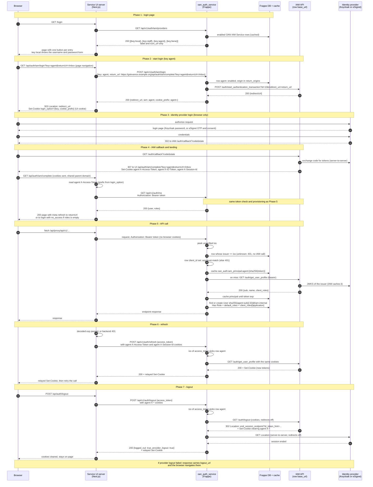

# IAM Login Discovery Flow (Service UI → oan_auth_service → IAM → Identity provider)

Planned route of a login that a service UI (for example `oan_grievance_ui`) starts through this app, for any login option in the `OAN IAM Service` table: staff (Keycloak `staff` realm), agent (Keycloak `agent` realm), beneficiary (eSignet), or this app's own local login.

How this was written:

- **Code, not observed.** This is the flow of `IAM_LOGIN_DISCOVERY_PLAN.md`. This app's side (Phases 1, 2, 5 and 7) is implemented and covered by tests with IAM faked; nothing was traced against a running stack. The UI side is not built yet.
- **What exists today and was read:** this app (`api/iam_tokens.py`, `api/iam_users.py`, `api/v1/auth.py` `get_me`, `gateway_apisix.py`), `oan_grievance_ui` at `bdafa84` (`src/lib/{iamSession,activeSession,env}.ts`, `app/api/auth/staff/{login,complete}`), and `IAM_DELEGATED_LOGIN_FLOW.md`, which describes today's single-IAM staff login.
- **IAM behaviour** is from `iam-service` branch `1.4` (`a073fa2`): `iam_core` `AuthService`, `TokenValidatorService`, `ProviderRepository`, the auth controllers of the staff, agent and bene APIs, and the `openg2p-iam-service` chart. Sources: `openg2p-developer/docs/agent-portal-login-flow.md`, `agent-cross-service-token-checks.md` and `beneficiary-portal-login-flow.md`.

## Components

| Name              | What it is                                                                                                                                                                                               |
| ----------------- | -------------------------------------------------------------------------------------------------------------------------------------------------------------------------------------------------------- |
| Browser           | The user's browser                                                                                                                                                                                       |
| Service UI server | Next.js route handlers of the service UI (`/api/auth/*`, `/api/proxy/*`). The only thing that calls this app. Never holds an IAM URL                                                                     |
| oan_auth_service  | This Frappe app. Holds the `OAN IAM Service` rows, starts logins, validates tokens by issuer, provisions users and roles                                                                                 |
| Frappe DB         | `OAN IAM Service` rows (cached as `oan_auth:iam_services`), `User`, `Has Role`                                                                                                                           |
| Frappe cache      | IAM principal per token (`oan_auth:iam_principal:{key}:{sha256(token)}`)                                                                                                                                 |
| IAM API           | One per login option's `base_url`: `iam-staff-portal-api`, `iam-agent-portal-api` or `iam-bene-portal-api`. Runs the OIDC code flow, sets cookies on the parent domain, holds the refresh token in Redis |
| Identity provider | Keycloak (`staff` or `agent` realm) or eSignet. Signs the tokens. Only the browser and IAM talk to it, except in logout                                                                                  |

Example rows used below:

| `key`   | `base_url`                      | `provider_id` | `issuer`                              | `application`  | `default_roles` | `cookie_prefix` | `return_origins`                |
| ------- | ------------------------------- | ------------- | ------------------------------------- | -------------- | --------------- | --------------- | ------------------------------- |
| `local` | —                               | —             | —                                     | —              | —               | —               | —                               |
| `staff` | `https://staff-iam.example.org` | `1`           | `https://kc.example.org/realms/staff` | `staff-portal` | —               | —               | `https://grievance.example.org` |
| `agent` | `https://agent-iam.example.org` | `10`          | `https://kc.example.org/realms/agent` | `agent-portal` | —               | `agent-`        | `https://grievance.example.org` |
| `bene`  | `https://bene-iam.example.org`  | `1`           | eSignet issuer                        | —              | `Farmer`        | `bene-`         | `https://grievance.example.org` |

## Sequence diagram

The local option is not in the diagram: its form posts to the existing `POST /api/v1/auth/login`, and the rest is this app's own session, unchanged.

## Step-by-step

### Phase 1 - login page

1. The UI server calls `GET /api/v1/auth/iam/providers`. This app reads the enabled rows from its cache, with no IAM call, and returns `key`, `label` and `icon_url` per row in `sort_order`.
2. The UI renders one button per entry. The `local` entry shows the username and password form instead of a button. An empty list shows nothing to sign in with.
3. An IAM that is down still has its button. The failure shows in Phase 2 as `503`.

### Phase 2 - start login

4. The button is a page navigation to the UI's own `/api/auth/iam/login?key=<key>&returnUrl=<path>`, not a `fetch`, because the browser must follow the identity provider's redirects.
5. The UI builds an absolute landing URL on its own origin, `https://<ui>/api/auth/iam/complete?key=<key>&returnUrl=<path>`, after `safeReturnPath(returnUrl)`.
6. `POST /api/v1/auth/iam/login {key, return_url}`. This app:
   - refuses an unknown, disabled or `local` key with `400`, before any IAM call;
   - refuses a `return_url` whose origin is not in the row's `return_origins` with `400`. A row with no origins refuses every login;
   - calls `POST {base_url}/auth/start_authentication_transaction?id=<provider_id>&redirect_uri=<return_url>` (5 s timeout, no redirects);
   - accepts only an `http`/`https` `redirectUrl`, and returns `{redirect_url, iam, cookie_prefix}`. IAM `4xx`: `502`. IAM down, timed out or `5xx`: `503`.
7. The UI stores `login_option={key, cookie_prefix}` in its own HttpOnly cookie, because it needs the prefix to find the token in Phases 4 to 7, and answers the browser `303` to `redirect_url`. A user who signed in through another OpenG2P UI skips Phases 1 to 4: the UI forwards its cookies to `GET /api/v1/auth/me`, which answers `login_option` and `cookie_prefix`.

### Phase 3 - identity provider login

8. Keycloak (password) or eSignet (OTP, biometrics, then the consent screen). IAM and the provider own this step; the UI and this app see none of it.

### Phase 4 - IAM callback and landing

9. The provider sends the browser to that IAM's `/auth/callback`. IAM exchanges the code, keeps the refresh token in its Redis, and redirects to the landing URL with its cookies on the shared parent domain, named with its prefix (`agent-X-Access-Token` and so on).
10. `/api/auth/iam/complete` reads `<cookie_prefix>X-Access-Token`. No readable token: back to login with `iam_failed`.
11. The UI asks this app for the user's roles with `GET /api/v1/auth/me` (Bearer), instead of decoding them from the token. This app runs the full token check of Phase 5 and returns the Frappe roles. Today's `hasAppAccess` reads roles from the token's `client_roles[IAM_APPLICATION]`, and an eSignet token has none, so it would refuse every beneficiary.
12. Empty `roles`: back to login with `no_access`, and the IAM session is left alone. Otherwise the UI clears any local session cookies and answers a page with a meta refresh to `returnUrl` or the role's home route (meta refresh, not `30x`, for the `SameSite=Strict` reason in `IAM_DELEGATED_LOGIN_FLOW.md` step 9).

### Phase 5 - API call

13. The UI proxy forwards with `Authorization: Bearer <token>` and no browser cookies, as today.
14. `peek_issuer` reads `iss` unverified. `iss == settings.issuer()`: own token, unchanged.
15. Otherwise the row whose `issuer` equals `iss`. No match: `401` with no IAM call. This is strict: IAM accepts any issuer in its own `login_providers` table and skips `aud`, so this app's `issuer` field is what separates staff, agent and beneficiary tokens.
16. Row has `client_id`: the unverified `azp` must equal it, else `401` with no IAM call. Safe to read unverified because IAM verifies the same token next.
17. Cache `oan_auth:iam_principal:{key}:{sha256(token)}`. A hit skips IAM. The issuer lookup runs first, so a disabled row cuts off its tokens at once, cached ones included.
18. Miss: `GET {base_url}/auth/get_user_profile`, Bearer, 5 s timeout. IAM finds the issuer in its table, verifies signature, `iss` and `exp` against the provider's JWKS, and returns the principal.
19. Principal cached until the token's `exp`. IAM also accepts the token until `exp`, so this adds no revocation lag.
20. User `sha256(f"{key}:{sub}")[:32]@iam.internal`, created on first sight. Roles = `default_roles` plus `client_roles[application]` when `application` is set, limited to existing Frappe roles. `sync_roles` makes `Has Role` exactly that set. No roles: `401`.
21. `application` set but no roles under it: warning in Error Log naming the row.
22. `frappe.set_user(user)`. Frappe DocPerm authorizes from here.

### Phase 6 - refresh

23. This app sees only the Bearer token, so it cannot refresh. IAM refreshes only from its own session cookie.
24. `POST /api/v1/auth/refresh {access_token}`, the same route as this app's own sessions. The token (expired is fine) goes in the body; its `iss` picks the row, as in Phase 5. The UI forwards that row's `<prefix>X-Access-Token`, `<prefix>X-Session-Id` and `<prefix>X-ID-Token` cookies. This app calls `{base_url}/auth/get_user_profile` with them, and relays IAM's `Set-Cookie` back. The UI relays them to the browser and retries.
25. Answers: `{refreshed: true}` with the new cookies, `{refreshed: false}` when the token was still valid, `401` when the session is over (no session cookie, or IAM refused), `503` when IAM is down (keep the session). A UI not yet switched can still call IAM's `get_user_profile` itself, which needs that IAM's URL in its env.

### Phase 7 - logout

26. `POST /api/v1/auth/logout {access_token}`, the same route as this app's own sessions, with the row's IAM cookies forwarded by the UI. The token's `iss` picks the row.
27. This app calls `GET {base_url}/auth/logout` with those cookies and redirects off. IAM deletes the refresh token and answers `302` to the provider's `end_session_endpoint` with `id_token_hint`, plus `Set-Cookie` headers that clear its cookies.
28. This app calls that `Location` server-to-server, redirects off, to end the identity provider's session. It relays IAM's `Set-Cookie` headers and returns `{logged_out: true, provider_logout: true}`.
29. Provider step failed: `{logged_out: true, provider_logout: false, logout_url}`. The UI navigates the browser to `logout_url`. IAM answered `401` (expired, refresh failed): `logged_out: true` anyway, and the UI clears its cookies.

## Cookies

| Cookie                                                                 | Set by                         | Domain               | Read by                                                                           |
| ---------------------------------------------------------------------- | ------------------------------ | -------------------- | --------------------------------------------------------------------------------- |
| `<prefix>X-Access-Token`, `<prefix>X-ID-Token`, `<prefix>X-Session-Id` | The row's IAM, at its callback | Shared parent domain | UI server (Phase 4 to 7), and this app only on the refresh and logout routes      |
| `<prefix>X-CSRF-Token`                                                 | The row's IAM                  | Shared parent domain | IAM, on state-changing routes. None of the routes this flow calls on IAM needs it |
| `login_option`                                                         | UI server, Phase 2             | UI origin            | UI server, to pick the cookie prefix that holds the token                         |

The prefix keeps portals apart. A browser logged in to two options sends both sets. The UI reads only the set named by `login_option`, so a user is never treated as the other portal's identity.

## Who calls whom

| Caller           | Callee                 | Route                                         | Token or cookies                        |
| ---------------- | ---------------------- | --------------------------------------------- | --------------------------------------- |
| UI server        | oan_auth_service       | `GET /api/v1/auth/iam/providers`              | None                                    |
| UI server        | oan_auth_service       | `POST /api/v1/auth/iam/login`                 | None                                    |
| oan_auth_service | IAM                    | `POST /auth/start_authentication_transaction` | None (CSRF-excluded)                    |
| Browser          | Identity provider, IAM | authorize, `/auth/callback`                   | Provider cookies, then IAM sets its own |
| UI server        | oan_auth_service       | `GET /api/v1/auth/me`, `/api/proxy/*` targets | Bearer                                  |
| oan_auth_service | IAM                    | `GET /auth/get_user_profile`                  | Bearer                                  |
| UI server        | oan_auth_service       | `POST /api/v1/auth/refresh`                   | IAM cookies of the row                  |
| UI server        | oan_auth_service       | `POST /api/v1/auth/logout`                    | IAM cookies of the row                  |
| oan_auth_service | IAM                    | `GET /auth/logout`                            | IAM cookies of the row                  |
| oan_auth_service | Identity provider      | `end_session_endpoint`                        | `id_token_hint`                         |

The UI never calls IAM or the identity provider. The browser reaches IAM only at `/auth/callback`, through the provider's redirect.

## Decisions and open points

Resolved, and now in `IAM_LOGIN_DISCOVERY_PLAN.md` or `IAM_LOGIN_UI_INTEGRATION_PLAN.md`:

- `POST /iam/login` returns the row's `cookie_prefix`. The UI keeps it with the key in its `login_option` cookie, because it needs the prefix to find the token and the key for refresh and logout.
- The UI takes roles from `GET /api/v1/auth/me`, never from the token. eSignet tokens carry no roles, and `default_roles` never appear in a token.
- The refresh proxy is implemented. Once a UI uses it, the UI needs no IAM URL at all.
- UIs forward the active option's IAM cookies on the refresh and logout calls only, behind their same-origin check.
- Logout needs no `return_origins` check: no caller URL is involved. Where the user lands after the provider logout is set in IAM (`default_redirect_uri`) and checked by the provider against the client's allowed post-logout redirect URIs.

Still open:

- That Keycloak ends the session from a server-side `end_session_endpoint` call (Phase 7).
- Whether eSignet tokens carry `azp` (Phase 5).
